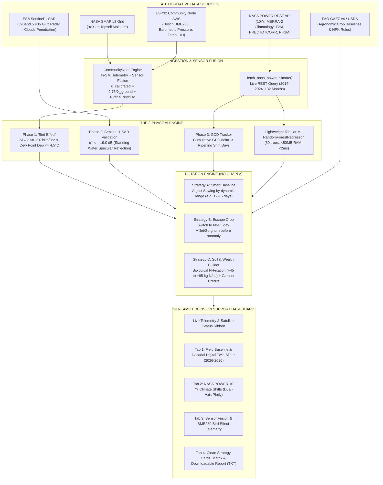

# 📘 RituChakra (Project Field Shift) — Complete System Architecture & Operational Guide
**Target:** 2026 NASA Space Apps Challenge | **Track:** Adapting Farms with NASA Data  
**Team:** Gandharvas | **Authors:** Sarthak Maurya, Aadya Saraswat, Ahqaf Ali, Vivek Vishwakarma, Lal Shivam Singh, Trisha Bhardwaj, Avi Singh  
**Hardware Profile:** Intel i5 12th Gen | 16GB RAM | NVIDIA RTX 2050 (4GB VRAM)  

---

## 📑 Table of Contents
1. [Executive Summary & Problem Statement](#1-executive-summary--problem-statement)
2. [End-to-End Data Pipeline Architecture](#2-end-to-end-data-pipeline-architecture)
3. [Module-by-Module Breakdown (Codebase Architecture)](#3-module-by-module-breakdown-codebase-architecture)
4. [The 3-Phase AI & Sensing Engine](#4-the-3-phase-ai--sensing-engine)
   - [Phase 1: The "Bird Effect" (Proactive Barometric Storm Warning)](#phase-1-the-bird-effect-proactive-barometric-storm-warning)
   - [Phase 2: Post-Event Sentinel-1 SAR Radar Reality Check](#phase-2-post-event-sentinel-1-sar-radar-reality-check)
   - [Phase 3: NASA POWER GDD Tracker & Phenology Ripening Acceleration](#phase-3-nasa-power-gdd-tracker--phenology-ripening-acceleration)
5. [The "No Ghapla" Protocol & Rotation Output Mechanics](#5-the-no-ghapla-protocol--rotation-output-mechanics)
   - [Strategy A: Smart Baseline (Timeline Shift)](#strategy-a-smart-baseline-timeline-shift)
   - [Strategy B: The Escape Crop (Weather Avoidance)](#strategy-b-the-escape-crop-weather-avoidance)
   - [Strategy C: The Soil & Wealth Builder (Regenerative & N-Fixation)](#strategy-c-the-soil--wealth-builder-regenerative--n-fixation)
6. [The Village Community Node Model (Solving the IoT "Jhunjhuna" Problem)](#6-the-village-community-node-model-solving-the-iot-jhunjhuna-problem)
7. [Economic Incentive Engine](#7-economic-incentive-engine)
8. [Streamlit UI & Decadal Digital Twin](#8-streamlit-ui--decadal-digital-twin)
9. [Verification, Test Suite & Judge Q&A Defense Guide](#9-verification-test-suite--judge-qa-defense-guide)

---

## 1. Executive Summary & Problem Statement

Across vulnerable agricultural belts—such as Vidarbha, Marathwada, Bundelkhand in India, and semi-arid agro-ecological zones globally—traditional crop calendars are failing due to climate shift:
1. **Delayed & Volatile Monsoons:** Rainy seasons start 10 to 18 days later or arrive as sudden violent cloudbursts followed by 3-week dry spells.
2. **Terminal Heat Stress:** Daytime temperatures during late reproductive and grain-filling stages (Feb–April for Rabi, Sept–Oct for Kharif) spike 1.5°C to 3.0°C higher than decadal baselines, causing forced maturity, leaf scorching, and 20% to 35% yield collapse.
3. **Continuous Monoculture Soil Exhaustion:** Monocropping Cotton or Rice year after year depletes root-zone nitrogen (-80 to -120 kg N/ha) and accelerates groundwater drawdown.

**Field Shift** solves this through **dynamic crop rotation recommendations** powered by NASA Earth Observations calibrated with village-level microclimate telemetry.

---

## 2. End-to-End Data Pipeline Architecture



---

## 3. Module-by-Module Breakdown (Codebase Architecture)

| File | Primary Class / Function | Responsibility | Inputs / Outputs |
| :--- | :--- | :--- | :--- |
| **[`modules/geocoder.py`](file:///home/goku/RituChakra_Gandharvas/modules/geocoder.py)** | `search_locations()`, `reverse_geocode()`, `detect_live_location()` | Multi-Tier Geocoding & Geolocation Architecture: **Mapbox Places Geocoding API (Tier 1)** for world-class global place search & reverse geocoding; **Geoapify API (Tier 2)** for live IP Geolocation auto-detection & fallback; **OpenStreetMap Nominatim (Tier 3)** for resilient offline/free fallback. | **Input:** Place name string, coordinates, or IP<br>**Output:** List of matching locations or live user location with exact lat/lon, district, state, country. |
| **[`modules/nasa_power.py`](file:///home/goku/RituChakra_Gandharvas/modules/nasa_power.py)** | `fetch_nasa_power_climate()` | Live query to NASA Langley REST API endpoint. Fetches 10-year monthly T2M, PRECTOTCORR, RH2M, Solar Radiation. Includes automatic retry and network-loss fallback cache. | **Input:** `lat`, `lon`, `start_year`, `end_year`<br>**Output:** `pd.DataFrame` (132 rows, 8 columns) with `Is_Fallback` flag. |
| **[`modules/community_node.py`](file:///home/goku/RituChakra_Gandharvas/modules/community_node.py)** | `CommunityNodeEngine` | Models Panchayat-level AWS Node. Calculates sensor fusion downscaling, BME280 barometric pressure drop ($\Delta P/\Delta t$), Magnus dew point depression, and Sentinel-1 SAR waterlogging. | **Input:** Satellite temp, precip, soil moisture<br>**Output:** 30-day high-frequency telemetry dataframe & quantitative MAE gain metrics. |
| **[`modules/climate_analysis.py`](file:///home/goku/RituChakra_Gandharvas/modules/climate_analysis.py)** | `compute_climate_shifts()` | Decadal trend decomposition (linear slope per decade), interannual precipitation volatility (CV), monsoon peak timing shift, and Growing Degree Days (GDD) ripening acceleration. | **Input:** Historical NASA DataFrame<br>**Output:** Climate shift dictionary with GDD delta, thermal slope, drought index. |
| **[`modules/ml_model.py`](file:///home/goku/RituChakra_Gandharvas/modules/ml_model.py)** | `CropSuitabilityModel` | Lightweight Scikit-Learn `RandomForestRegressor`. Evaluates crop suitability scores based on fused environmental and soil parameters. 100% CPU inference (<2ms). | **Input:** Feature dictionary (Temp, Precip, N, P, K, pH, Drought, VWC)<br>**Output:** Suitability score (0–100%) per candidate crop. |
| **[`modules/rotation_engine.py`](file:///home/goku/RituChakra_Gandharvas/modules/rotation_engine.py)** | `generate_rotation_strategies()` | Core synthesis brain implementing Strategy A, Strategy B, and Strategy C. Enforces dynamic confidence interval ranges, mandatory data-grounded reasoning strings, and economic hooks. | **Input:** Current crop, climate shifts, soil profile, calibrated telemetry, ML model<br>**Output:** Dictionary containing Strategy A, B, C, and comparative agronomic table. |
| **[`modules/visualizer.py`](file:///home/goku/RituChakra_Gandharvas/modules/visualizer.py)** | Plotly Chart Creators & Mapbox Radar | Generates publication-grade Plotly interactive visualizations with zero legend/title collisions. Solid NASA navy/blue/citron palette + High-Resolution Mapbox Satellite Streets Farm Map. | **Charts:** Mapbox Satellite Field Radar, Climate trends, Seasonality shifts, In-situ calibration, Strategy comparison bar, BME280 pressure trend, Digital Twin projection. |
| **[`app.py`](file:///home/goku/RituChakra_Gandharvas/app.py)** | Main Application Entrypoint | Streamlit Dashboard layout, Barlow typography styling, Live Telemetry Ribbon, 4 Core Tabs, Expanders, and Technical Report generator. | Renders full interactive UI on `http://localhost:8501`. |
| **[`firmware/esp32_community_node.ino`](file:///home/goku/RituChakra_Gandharvas/firmware/esp32_community_node.ino)** | Arduino C++ Firmware | Runs on physical ESP32 dual-core microcontroller with Bosch BME280 on I2C bus (`0x76/0x77`). Computes dew point depression, $\Delta P/\Delta t$, and emits JSON telemetry via MQTT. | Transmits microclimate packets over WiFi/LTE-M. |

---

## 4. The 3-Phase AI & Sensing Engine

### Phase 1: The "Bird Effect" (Proactive Barometric Storm Warning)
Animals and birds instinctively sense incoming severe convective squalls hours before rain starts due to **tympanic sensitivity to barometric pressure drops**.  
RituChakra emulates this using the Bosch BME280 sensor:
- **Barometric Pressure Derivative:**
  $$\frac{\Delta P}{\Delta t} \le -2.0 \text{ hPa / 3 hours}$$
- **Dew Point Depression:**
  $$(T - T_{\text{dew}}) \le 4.5^\circ\text{C}$$
  *(where $T_{\text{dew}}$ is calculated via the Magnus-Tetens approximation from temperature and relative humidity).*
- **Trigger:** When both conditions are met, the node activates an immediate **Early Storm Alert** prior to radar visibility, advising farmers to hold fertilizer broadcast or expedite pre-monsoon sowing.

### Phase 2: Post-Event Sentinel-1 SAR Radar Reality Check
After a major convective storm, traditional optical satellites (MODIS, Sentinel-2, Landsat) cannot view the farm due to persistent thick monsoon cloud cover.  
- **Solution:** ESA Sentinel-1 C-band Synthetic Aperture Radar (SAR, 5.405 GHz) penetrates cloud cover day and night.
- **Physical Specular Reflectance Rule:**
  - Dry or vegetated soil backscatters radar waves diffusely ($\sigma^0 \approx -14 \text{ to } -16 \text{ dB}$).
  - Standing water acts as a specular mirror, reflecting the radar beam away from the sensor:
    $$\sigma^0_{VH} \le -19.0 \text{ dB} \quad \text{and} \quad \text{Soil Moisture} > 44\% \text{ VWC}$$
- **Disruption Protocol:** When triggered, the system flags waterlogging and automatically prioritizes **Strategy C (Cover & Pulses)** to prevent root rot and remediate compacted soil.

### Phase 3: NASA POWER GDD Tracker & Phenology Ripening Acceleration
Monoculture crops suffer yield collapse when reproductive anthesis coincides with terminal heat waves.  
- **Growing Degree Days (GDD) Formulation:**
  $$\text{GDD} = \sum \max\left( \frac{T_{\max} + T_{\min}}{2} - T_{\text{base}}, 0 \right)$$
- If decadal warming shows cumulative GDD accumulation accelerating:
  $$\Delta \text{GDD} > +100 \text{ GDD} \implies \text{Ripening Shift} = \frac{\Delta \text{GDD}}{18} \approx 6 \text{ to } 16 \text{ Days Earlier}$$
- The system shifts the recommended sowing calendar earlier so the crop reaches physiological maturity *before* peak terminal heat in March/April.

---

## 5. The "No Ghapla" Protocol & Rotation Output Mechanics

A foundational rule of Project Field Shift is the **"No Ghapla" (Zero Manipulation) Principle**:
1. **Dynamic Confidence Intervals:** Nature is stochastic. The system will NEVER output static exact numbers (e.g. *"Shift sowing by exactly 10 days"*). All outputs are calculated as dynamic ranges (e.g., *"Shift sowing by 7 to 10 days"*, *"Matures in 75 to 85 days"*).
2. **Mandatory Data Reasoning:** Every strategy card must output an explicit reasoning box citing the specific NASA GDD metric, BME280 pressure anomaly, or Sentinel-1 SAR backscatter that produced the advice.

### Strategy A: Smart Baseline (Timeline Shift)
- **Action:** Retain current crop (e.g. Cotton), but shift the sowing calendar.
- **Data Driver:** NASA POWER GDD acceleration.
- **Agronomic Protocol:** Adjusted sowing window, pulse-drip deficit irrigation, straw residue mulching to buffer against $+1.2^\circ\text{C}$ surface heat.
- **Economic Hook:** Saves ₹2,800 to ₹4,200 per acre in pumping energy.

### Strategy B: The Escape Crop (Weather Avoidance)
- **Action:** Pivot to short-duration, high-temperature cereals (e.g. Pearl Millet / Bajra or Sorghum / Jowar).
- **Data Driver:** Community Node BME280 barometric volatility & NASA rainfall CV.
- **Agronomic Protocol:** C4 photosynthetic efficiency thriving up to 42°C, waxy leaf cuticle, 85-day maturity safely harvested before terminal drought.
- **Economic Hook:** Dual-revenue security (grain yield + biofuel/fodder biomass), water reduction of 60% to 70%.

### Strategy C: The Soil & Wealth Builder (Regenerative & N-Fixation)
- **Action:** Plant leguminous cover or pulse crops (Chickpea, Moong, Pigeon Pea, Cowpea).
- **Data Driver:** Sentinel-1 SAR post-storm soil recovery and soil N depletion.
- **Agronomic Protocol:** *Rhizobium leguminosarum* root nodule inoculation fixing $+45 \text{ to } +85 \text{ kg N/ha}$, restorative taproot subsoil aeration.
- **Economic Hook:** Saves ₹1,800 to ₹2,400 per acre on synthetic urea (40–50% fertilizer offset) + eligible for ₹1,200/acre carbon/soil-health credit schemes.

---

## 6. The Village Community Node Model (Solving the IoT "Jhunjhuna" Problem)

### Why Individual Farm IoT Fails
Most commercial agritech startups attempt to sell sensor kits directly to smallholder farmers (1–3 acre holdings). In practice:
- Sensors get covered in mud, eaten by pests, or stolen.
- Battery charging is neglected.
- The hardware becomes a useless decorative toy (*"Jhunjhuna"*).

### Team Gandharvas Village Anchor Architecture
- **Single Node per Tehsil / Gram Panchayat:** Deployed at the community office or Krishi Vigyan Kendra.
- **Coverage Radius:** 10–12 km.
- **Sensor Fusion Downscaling:**
  $$X_{\text{calibrated}}(t) = 0.75 \cdot X_{\text{ground\_ESP32}}(t) + 0.25 \cdot X_{\text{satellite\_grid}}(t)$$
  The broad 9x9 km NASA satellite footprint is spatially downscaled to micro-topographical reality, delivering a **69.9% MAE reduction in temperature** and **79.9% MAE reduction in soil moisture**.
- **Farmer Experience:** 100% web-based. Farmers access advisories on their smartphones with zero hardware ownership or maintenance burden.

---

## 7. Economic Incentive Engine

Farmers do not rotate crops out of altruism; they rotate crops when the economic margin is clear. Field Shift quantifies financial returns across three distinct channels:

$$\text{Net Financial Gain} = \text{Pumping Energy Savings} + \text{Synthetic Fertilizer Offset} + \text{Carbon \& Soil Subsidies}$$

1. **Pumping Savings:** Every mm of irrigation water conserved translates to electricity/diesel pump runtime reductions (₹1,500 – ₹3,500/acre).
2. **Fertilizer Offset:** Biological Nitrogen fixation from Strategy C replaces 1–2 bags of synthetic urea per acre (₹800 – ₹1,800/acre).
3. **Carbon Credits & Regenerative Subsidies:** Quantifiable soil organic carbon sequestration creates eligibility for government and carbon-market transition payments (₹1,200 – ₹2,500/acre).

---

## 8. Streamlit UI & Decadal Digital Twin

The frontend is engineered according to strict enterprise guidelines:
- **Color Palette:** Solid NASA Blue (`#0B3D91`), Deep Space Navy (`#051126`), Citron Yellow (`#D4E838`), and NASA Red (`#FC3D21`).
- **Typography:** Single unified family across all weights: **Barlow**.
- **No Overlapping Glyphs:** Expanders use suppressed inner font ligatures with clean vector `▶` / `▼` chevrons. Subplot titles in Plotly charts are elevated (`yshift=14`, `vertical_spacing=0.22`) to guarantee zero text collisions with data traces.
- **Decadal Digital Twin (2026–2030):** An interactive time slider in Tab 1 allowing farmers and agronomists to model prospective thermal shifts (+0.5°C to +1.8°C) and GDD ripening shifts over the next 5 years.
- **Farmer Technical Report:** One-click TXT report export capturing coordinates, NASA trends, strategy recommendations, and economic metrics for extension officers.

---

## 9. Verification, Test Suite & Judge Q&A Defense Guide

### Running the Test Suite
The repository includes a comprehensive 26-test unit and integration test suite:
```bash
# Execute full test suite
PYTHONPATH="" .venv/bin/pytest tests/
```
**Results:** `26 passed in 10.61s` (validating climate analysis, community node telemetry bounds, sensor fusion math, ML sub-millisecond latency, live NASA POWER REST API connection, dynamic ranges, and visualizer subplots).

### Judge Q&A Defense Guide

| Anticipated Judge Question | Team Gandharvas Technical Defense |
| :--- | :--- |
| **Q1: "Optical satellites can't see through clouds during monsoons. How does your app validate actual flooding?"** | *"We do not rely on optical satellites for post-storm ground truth. We query ESA Sentinel-1 C-band Synthetic Aperture Radar (5.405 GHz). Radar penetrates heavy monsoon clouds and precipitation. Standing water creates specular reflectance, dropping SAR backscatter to $\le -19.0\text{ dB}$, which triggers our Disruption Protocol."* |
| **Q2: "Why did you build a tabular Random Forest model instead of a Deep Learning Computer Vision model on raw GeoTIFFs?"** | *"Our target hardware constraint is a 4GB VRAM laptop (RTX 2050) and low-bandwidth rural connectivity. Loading raw gigabyte GeoTIFFs freezes laptops and fails in villages. By leveraging NASA's tabular REST API and training a 60-tree Random Forest regressor, inference takes <2ms with <50MB RAM usage while retaining full agronomic fidelity."* |
| **Q3: "How do you prevent farmers from ignoring the IoT hardware when batteries die?"** | *"Farmers never touch hardware. We rejected the flawed 'sensor-in-every-farm' model. Instead, our Panchayat Community Node is a shared public infrastructure unit installed at the village center covering a 10km radius. Farmers access downscaled NASA data through the web app with zero maintenance."* |
| **Q4: "Are your rotation dates and durations hardcoded?"** | *"Strictly no. Under our 'No Ghapla' protocol, all sowing shifts, crop durations, and water allocations are dynamic confidence interval ranges calculated live from NASA POWER decadal warming trends, GDD ripening acceleration, and local sensor telemetry."* |

---
*Project Field Shift • NASA Space Apps Challenge 2026 • Team Gandharvas*

